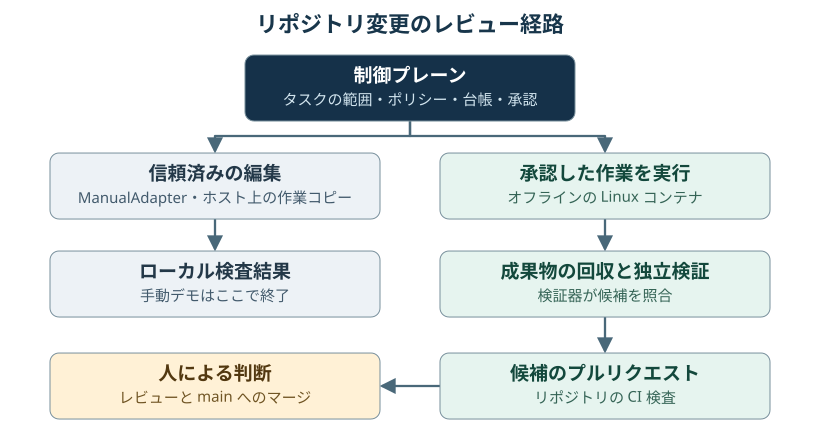

# AI Governance Control

[English](README.md) · [日本語](README.ja.md)

人やコーディングエージェントが作った変更を、リポジトリの管理者が受け入れるための制御基盤です。タスクに変更範囲を記し、検証器が候補に対応する証拠を確認し、人が `main` に取り込むかを判断します。

**実験段階 · MANUAL_ONLY · Python 3.11以上。** 現在使えるのは、信頼済みの編集を手元で検査する経路と、登録した作業をオフラインのLinuxコンテナで実行する経路です。外部ツールを呼ぶエージェントや、別のエージェントへの委譲を管理する仕組みは設計段階です。

| やりたいこと | 入口 |
|---|---|
| 人・Codex・Claude Codeが行った編集を確認する | [ローカルデモの手順](docs/getting-started.md) |
| 承認した作業をオフラインのLinuxコンテナで実行する | [コンテナ実行の手順](docs/operations/APPROVED_CONTAINER_LOOP.md) |
| 読み取り専用アシスタント、ツール実行、作業委譲を設計する | [エージェントのユースケースと設計](docs/agent-workflows/README.ja.md) |
| 自分の環境で使える機能と制約を確認する | [現在の状態](docs/operations/PROJECT_STATE.md) · [対応環境](docs/compatibility/matrix.md) |

## 作業からレビューまで



[図のソース](docs/diagrams/architecture.ja.mmd) · [アーキテクチャ仕様](docs/architecture/ARCHITECTURE.md)

### 適用される制御

手動デモは既存の作業コピーで登録済みコマンドを実行します。ホスト上で動作し、タスクのパス制限を強制しないため、信頼できるコードに使います。隔離経路では、回収票の `COLLECTED` は成果物を受け取った段階です。合否は独立検証器が判定します。完全差分の検証を必須とする引き渡しは現在受け付けません。高影響の操作には人の承認が必要で、マージは人が行います。自動デプロイは対象外です。

## ローカルデモを試す

クローンしたリポジトリでPython 3.11以上の仮想環境を有効にして実行します。

```bash
pip install -e ".[dev]"
python -m orchestrator.cli doctor
python -m orchestrator.cli demo --task-file tasks/templates/basic-task.yaml --worktree .
```

正常な `MANUAL_ONLY` 環境では `doctor` の終了コードは2です。デモの結果は次のコマンドが表示します。導入方法、自分のリポジトリでの使い方、出力の読み方は[はじめに](docs/getting-started.md)を参照してください。

## フォルダ案内

| フォルダ | 主な内容 |
|---|---|
| [tasks](tasks/) · [schemas](schemas/) · [config](config/) | タスクの例、検証用スキーマ、実行プロファイル |
| [orchestrator/core](orchestrator/core/) · [orchestrator/adapters](orchestrator/adapters/) | ポリシー、リース、台帳、承認、検証、アダプターの実装 |
| [tests](tests/) · [scripts](scripts/) | テストとCIで使う検査 |
| [docs/agent-workflows](docs/agent-workflows/README.ja.md) · [docs/architecture](docs/architecture/) | エージェントのユースケース、操作の設計、現行構成、ロードマップ |
| [docs/operations](docs/operations/) · [docs/security](docs/security/) · [docs/research](docs/research/) | 運用手順、信頼境界、研究資料 |

[文書索引](docs/README.md) · [アダプター](docs/adapters/README.md) · [貢献ガイド](CONTRIBUTING.md) · [セキュリティ](SECURITY.md) · [名称変更の経緯](docs/operations/repository-url-migration.md) · [MITライセンス](LICENSE)
