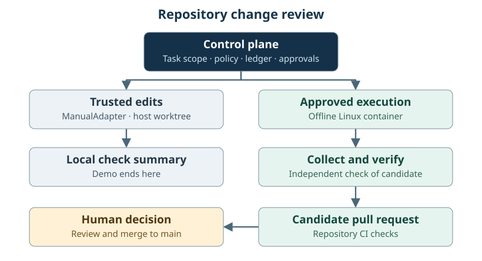

# AI Governance Control

[English](README.md) · [日本語](README.ja.md)

AI Governance Control helps a repository owner decide whether to accept work produced by a person or a coding agent. The task describes what may change, the verifier checks evidence for the candidate, and a human decides whether it belongs on `main`.

**Experimental · MANUAL_ONLY · Python 3.11+.** You can check a trusted edit today. A bounded Linux worker can run through the approved-container path. Governing an agent that calls external tools or delegates work is the next design step.

| What do you want to do? | Where to start |
|---|---|
| Check a change made by a person, Codex or Claude Code | [Run the local demo](docs/getting-started.md) |
| Run a registered job in an offline Linux container | [Approved container loop](docs/operations/APPROVED_CONTAINER_LOOP.md) |
| Design a read-only assistant, a tool-using agent or a delegated task | [Agent workflows and proposed controls](docs/agent-workflows/README.md) |
| Decide which guarantees apply in your environment | [Project state](docs/operations/PROJECT_STATE.md) · [Compatibility](docs/compatibility/matrix.md) |

## How work reaches review



[Diagram source](docs/diagrams/architecture.en.mmd) · [Architecture specification](docs/architecture/ARCHITECTURE.md)

### Safety model

The local demo runs registered validation commands against an existing worktree. Use it with trusted code. It runs on the host and does not enforce task path restrictions. On the isolated path, a collection receipt means `COLLECTED`; the independent verifier makes its own decision. Handoffs requiring complete-diff verification are currently refused. High-impact operations require human approval. The product reserves merging for a human and supports no automatic deployment.

## Try the local demo

From a clone, activate a Python 3.11+ virtual environment, then run:

```bash
pip install -e ".[dev]"
python -m orchestrator.cli doctor
python -m orchestrator.cli demo --task-file tasks/templates/basic-task.yaml --worktree .
```

A healthy `MANUAL_ONLY` installation returns exit code 2 from `doctor`. The demo prints its own result. For installation, your own repository, and how to read the output, follow the [walkthrough](docs/getting-started.md).

## Repository map

| Folder | What it owns |
|---|---|
| [tasks](tasks/) · [schemas](schemas/) · [config](config/) | Task examples, validation contracts and execution profiles |
| [orchestrator/core](orchestrator/core/) · [orchestrator/adapters](orchestrator/adapters/) | Policy, leases, ledger, approvals, verification and adapter implementations |
| [tests](tests/) · [scripts](scripts/) | Tests and the checks used in CI |
| [docs/agent-workflows](docs/agent-workflows/) · [docs/architecture](docs/architecture/) | Agent use cases, proposed action lifecycle, current architecture and roadmap |
| [docs/operations](docs/operations/) · [docs/security](docs/security/) · [docs/research](docs/research/) | Operator guides, trust boundaries and research notes |

[Documentation index](docs/README.md) · [Adapters](docs/adapters/README.md) · [Contributing](CONTRIBUTING.md) · [Security](SECURITY.md) · [Project history](docs/operations/repository-url-migration.md) · [MIT license](LICENSE)
