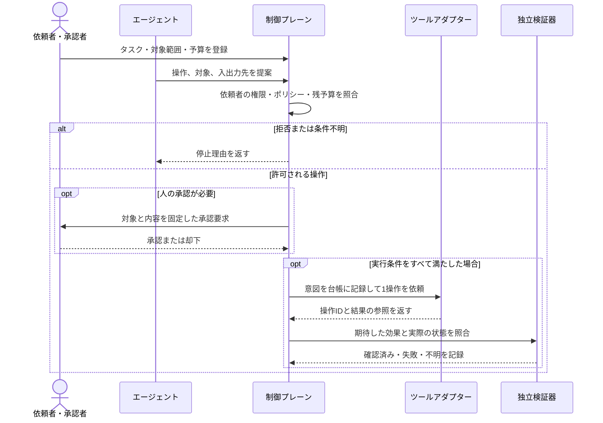

# エージェントのユースケースと制御設計

[日本語](README.ja.md) · [English](README.md) · [現行アーキテクチャ](../architecture/ARCHITECTURE.md)

チャットでAIが文案を返すと、人がそれを使うか決められる。エージェントが文書の検索、ファイル編集、第三者への送信まで行う場合は、**各操作の直前**に、依頼者にその権限があるか、どのデータをどこに渡すかを判断する必要がある。本ページはその拡張設計である。以下の操作要求やコネクターは将来の契約案で、現行CLIの入力形式は[タスクのスキーマ](../../schemas/task.schema.json)に従う。

## ユースケース別の入口

| 利用場面 | 現在使えるもの | 次に必要な制御 |
|---|---|---|
| 人がAIの提案を読み、コードを編集 | 信頼済み作業コピーでの[手動検査](../adapters/manual.md) | 人が編集と結果を照合する。ホスト上のデモに隔離の保証はない |
| 外部コーディングエージェントの変更をレビュー | 手動で編集結果を渡す経路と、登録済み作業向けの[オフラインLinux実行](../operations/APPROVED_CONTAINER_LOOP.md) | 検証対象を候補に結び付ける。ネイティブなCodex・Claude Code実行は未提供 |
| 社内文書を検索して回答案を作る | 設計段階。初回は合成文書を使うオフライン試験 | 依頼者が読める文書集合、引用元、返却先を限定する |
| 問い合わせの返信案を作り、承認後に送る | 設計段階。草案の保存と送信を別々の操作にする | 宛先・本文・アカウントを承認に結び付け、送信結果を照合する |
| 親エージェントが要約を子に委譲 | 設計段階。Builder・Tester・Reviewerは現在は[役割定義](../../AGENTS.md) | 子のデータ・ツール・予算を親の許可内に限定し、親の取消を子へ伝える |

## 提案する実行経路

### 誰が何を決めるか

- **操作を提案する側**はタスクID、依頼者、担当ワーカー、操作名、対象、宛先、入力の参照を渡す。モデルや取得文書が出した命令も提案として扱う。ツールの実体、認証情報、許可範囲はホストが解決する。
- **制御プレーン**は依頼者の実効権限とタスクの許可範囲の共通部分を使う。読み取りも対象・返却先を検査し、書き込みは対象の版と副作用を確認する。人による承認は操作、入力のダイジェスト、宛先、ポリシーの版、有効期限に結び付ける。変更・期限切れ・取消は実行前に再判定し、明示禁止は承認でも解除しない。
- **アダプター**は許可された1操作だけを扱う。操作IDと外部の参照を台帳に残し、応答が途切れたら「結果不明」とする。再開時は外部状態を読み戻す。効果を確定できない書き込みは担当者に戻す。親子を含む呼び出し数、経過時間、費用の上限は試行をまたいで管理する。
- **検証器と運用者**は、草案なら保存された内容、外部操作なら対象システムでの効果を確認する。台帳にはタスク・操作・親子関係・判断理由・証拠の参照を残す。本文や認証情報の保管先と閲覧権限は台帳から切り離す。メモリから復元した計画にも現在の権限と期限を適用する。

例：返信先Aへの承認後にエージェントが宛先をBに変えたら、元の承認では送信できない。宛先Aへの送信要求がタイムアウトした場合は、同じ操作IDで送信済み記録を照合する。見つかれば既存結果を返し、確定できなければ「不明」で止める。

## 実装順と受け入れ条件

| 段階 | 再利用するもの | 次へ進む条件 |
|---|---|---|
| G1　操作契約と評価 | [候補の識別](../architecture/candidate-binding.md)、[評価レコード](../architecture/governance-assessment-contract.md) | 合成の読み取り・草案・送信を区別でき、タスクや宛先の異なる要求を検出できる |
| G2–G3　承認と役割 | [承認コンテキスト案](../architecture/approval-context-preview.md)、既存の署名承認・権限台帳 | 別の宛先、古い承認、取消済みの担当者、親の範囲を超えた委譲で副作用が発生しない |
| G4　オフライン試験 | [状態通知の契約](../architecture/status-notification-contract.md)、独立検証と台帳 | 合成の返信案で承認、拒否、取消、応答欠損、再起動を確認。二重実行数・照合不能数・レビュー時間を記録する |
| G5　外部アダプター1件 | [アダプター境界](../adapters/README.md)、[既存ロードマップ](../architecture/governance-roadmap.ja.md) | 最初は所有者管理の読み取り専用接続で、限定権限・停止・監査を確認する。書き込みの開放は別に判断する |

現行の候補・評価・承認プレビューは単独で検証できる部品である。外部操作の認可まで接続する実装と、実サービスでの効果確認が次の開発対象になる。現行の保証は[プロジェクト状態](../operations/PROJECT_STATE.md)を参照。
