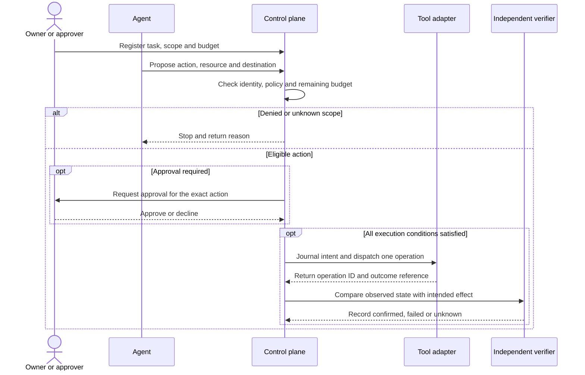

# Governing agent workflows

[English](README.md) · [日本語](README.ja.md) · [Current architecture](../architecture/ARCHITECTURE.md)

When AI drafts text, a person chooses what to do with it. When an agent searches records, edits files or sends a message, the decision must also happen **before each tool action**. This design assigns responsibility for that decision and for checking its outcome. The proposed action records and connectors below are design targets. The current CLI accepts the existing [task schema](../../schemas/task.schema.json).

## Choose a workflow

| Use case | Available today | Control to apply or design |
|---|---|---|
| A person edits code using an AI suggestion | [Manual checks](../adapters/manual.md) on a trusted worktree | The operator reviews the edit and local results. The demo runs directly on the host |
| Review a change produced by a coding agent | Manual handoff of an external edit; [offline Linux execution](../operations/APPROVED_CONTAINER_LOOP.md) for registered work | Bind evidence to the candidate. Native Codex and Claude Code execution are unavailable |
| Search internal documents and draft an answer | Proposed; start with offline fixtures | Restrict the readable corpus to the requester's permissions and check citations and the response destination |
| Draft a support reply and send it after approval | Proposed; saving a draft and sending it are separate actions | Bind recipient, content and account to approval; reconcile delivery |
| Delegate summarization to another agent | Proposed; Builder, Tester and Reviewer are [role definitions](../../AGENTS.md) today | Bound child data, tools and budget by the parent grant; propagate cancellation |

## Proposed action lifecycle

### Ownership and recovery

- **The proposer** supplies task ID, requester, worker, operation, resource, destination and an input reference. Treat instructions in model output or retrieved documents as proposals. The host resolves tool identity, credentials and grants.
- **The control plane** intersects the requester's permissions with task scope. Check the resource and output audience for reads; check the target version and effects for writes. Bind approval to the action, input digest, destination, policy revision and expiry. Recheck changes, expiry and revocation at dispatch. Hard denies take precedence.
- **The adapter** executes one admitted operation. Journal its intent and stable operation ID before calling the tool. A lost response produces an unknown outcome. On restart, read back external state and return ambiguous writes to the operator. Count calls, elapsed time and cost across retries and child tasks.
- **The verifier and operator** inspect the stored draft or the actual effect at the destination. Record task and operation IDs, parentage, decision reason and evidence references. Keep payloads and credentials in access-controlled storage outside the ledger. Recheck current grants and expiry when loading a saved plan.

Example: if the worker changes the recipient after a reply was approved, it must request a new approval. If a send times out, look up the previous operation at the destination. Return the existing receipt if confirmed; otherwise keep the outcome unknown.

## Available now: synthetic operation previews

The offline [operation intent preview](../../orchestrator/core/operation_intent.py)
checks a synthetic read, draft or send against a controller-pinned task, requester,
resource, destination, sending account (where applicable) and input digest.
Both the requester grant and the task scope must cover the exact same tuple.

The [revision preview](../../orchestrator/core/operation_revision.py) additionally
checks a claimed draft/send resource revision against an independent prior pin
and observed resource/revision pair. The [assessment bridge](../../orchestrator/core/operation_assessment_bridge.py)
gets the operation IDs from an independently pinned assessment record and uses
the revision preview for draft/send without falling back to v1.

The same module's `evaluate_review_consistency` recomputes the current
draft/send preview and compares its full intent, target revision and assessment
digest with a separately retained fixture snapshot. The snapshot binds only
that operation, not the complete grant sets or their provenance.
A changed destination, for example, does not match the prior snapshot even if
the current fixture scopes now cover it. Do not construct the prior snapshot
from the current proposal or current pins. A match does not prove that anyone
reviewed the operation, authenticate an approver, or verify expiry or revocation.

These modules are for synthetic fixtures. A match is `MANUAL_ONLY` with no
execution authorization. They do not issue approvals, access credentials, call
external tools, attest to source authenticity, or guarantee the resource has
not changed again. Live admission, delegation, execution-time revision binding
and effect verification are not implemented by this path.

## Delivery and acceptance

| Stage | Reuse | Evidence needed to advance |
|---|---|---|
| G1 · Action and assessment | [Candidate binding](../architecture/candidate-binding.md) and [assessment records](../architecture/governance-assessment-contract.md) | Distinguish a synthetic read, draft and send; detect a mismatched task or destination |
| G2–G3 · Authority and roles | [Approval context preview](../architecture/approval-context-preview.md), signed approvals and registry | Changed destination, stale approval, revoked operator and out-of-scope delegation produce no side effects |
| G4 · Offline pilot | [Status contract](../architecture/status-notification-contract.md), verification and ledger | Exercise success, denial, cancellation, lost reply and restart on a synthetic support draft. Measure duplicate effects, unresolved outcomes and review time |
| G5 · One external adapter | [Adapter boundary](../adapters/README.md) and [governance roadmap](../architecture/governance-roadmap.md) | Demonstrate bounded access, cancellation and audit on one owner-controlled read-only integration. Decide write access separately |

Candidate, assessment and approval-preview contracts can be checked independently today. Connecting them to tool admission and verifying external effects are implementation milestones. See [project state](../operations/PROJECT_STATE.md) for current guarantees.
