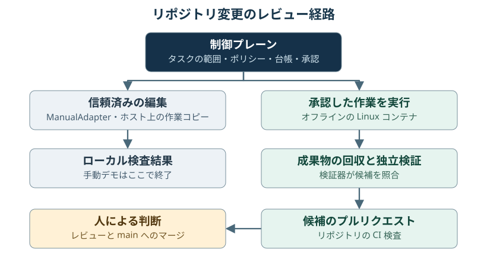
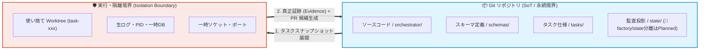
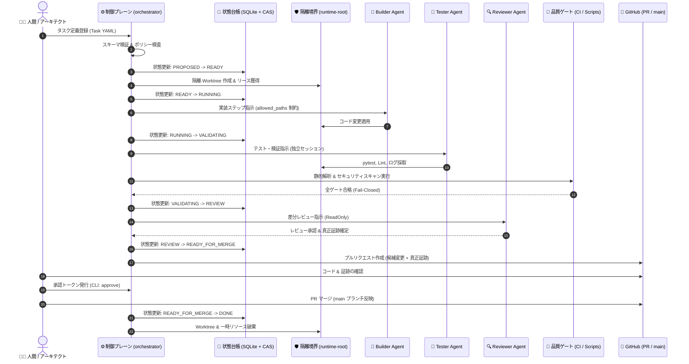

# Architecture Specification (v1.0)

## 0. Current vs Target: 読み方の注意

§1は現在の実行経路、§2以降は制御原則・境界・目標シーケンスを記す。実装の可否は[現在の状態](../operations/PROJECT_STATE.md)とソースで確認する。外部ツールと委譲を含む目標設計には[エージェントの操作ライフサイクル](../agent-workflows/README.ja.md)を用いる。

## 1. システムアーキテクチャ全体像



| 責務 | 現行実装と範囲 |
|---|---|
| タスク・ポリシー・スケジュール | [CLI](../../orchestrator/cli.py)、[PolicyEngine](../../orchestrator/core/policy.py)、[スケジューラー](../../orchestrator/core/scheduler.py)、[実行ループ](../../orchestrator/core/loop.py) |
| 状態と承認 | [SQLite台帳](../../orchestrator/core/state.py)、[署名承認](../../orchestrator/core/approval.py)、[承認者の認証](../../orchestrator/core/auth.py) |
| 実行 | [ManualAdapter](../../orchestrator/adapters/manual.py) と [ApprovedContainerAdapter](../../orchestrator/adapters/container.py)。ホスト上の手動デモには隔離がない |
| 証拠と公開 | [成果物の回収](../../orchestrator/core/artifacts.py)、[独立検証](../../orchestrator/core/verifier.py)、[GitHubアダプター](../../orchestrator/adapters/github.py)。回収票は `COLLECTED` まで |
| エージェントの役割 | [Builder・Tester・Reviewer](../../AGENTS.md) は責務の定義。独立した3つのエージェントプロセスの実装は計画段階 |
| 接続の制約 | Antigravityネイティブ接続はBLOCKED。Codex・Claude Codeは外部で生成した編集を手動で引き渡せる。完全差分必須の引き渡しは拒否される |

[English overview](../diagrams/architecture.en.svg) · [図のソース](../diagrams/architecture.ja.mmd) · [運用手順](../operations/OPERATIONS.md)

## 2. 設計の基本原則 (Core Principles)

| 原則 | 目的・動機 | 実装機構 |
| :--- | :--- | :--- |
| **単一の状態書き込み**<br>*(Single Writer)* | 複数エージェントや分散プロセスによる競合・デッドロック・状態不整合の完全排除。 | 状態遷移は `orchestrator/core/state.py` の SQLite トランザクションと CAS (Compare-And-Swap) リビジョン番号で直列化。分散 Git ロックは禁止。 |
| **重要操作は承認必須**<br>*(Human-in-the-Loop)* | AI エージェントのハルシネーションや不正コードによる本番破壊・予期せぬ外部公開を防止。 | • `main` ブランチ直接 push 禁止（保護ルール必須）。<br>• 自動マージ・自動本番デプロイの全面禁止。<br>• 承認トークン（CLI: `orchestrator.cli approve`）と人間レビュー必須。 |
| **永続記憶はリポジトリ中心**<br>*(Git-backed SoT)* | すべての成果物・仕様・検証結果の再現性・監査性を長期的に担保。 | • `main` ブランチがコードおよび仕様（スキーマ・タスク定義）の真実の源泉 (SoT)。<br>• 監査用イベント履歴は現状 `main` の `state/` ディレクトリ配下に投影（`factory/state` ブランチへの分離は🚧Planned）。 |
| **SoT と使い捨てランタイムの完全分離**<br>*(Isolation Boundary)* | エージェントによるリポジトリ汚染、未管理ファイルの残留、シークレット漏洩の防止。 | 作業はすべて Git 外の `runtime-root` 配下の使い捨て Worktree で実行。生ログ、PID、一時DB、ソケットはリポジトリ外に閉じ込める。 |
| **安全側への倒しこみ**<br>*(Fail-Closed Validation)* | 境界外アクセスや未登録コマンド、未知スキーマのすり抜けを一切許容しない。 | 不明なスキーマフィールドの拒否、`shell=True` の排除、未定義コマンドの拒絶、CI 1項目失敗での即時停止。 |

---

## 3. 隔離境界: Git リポジトリ vs `runtime-root`

エージェントがアクセス可能な領域と、長期的な信頼境界は明確に物理分離されています。

| 領域 | 格納対象 | 保持期間 | アクセス権限 | 監査性 |
| :--- | :--- | :--- | :--- | :--- |
| **Git リポジトリ (SoT)**<br>`main`（`factory/state`は🚧Planned、現状は`state/`が`main`配下） | • 仕様・スキーマ (`schemas/`)<br>• 制御プレーン実装 (`orchestrator/`)<br>• タスク定義 (`tasks/`)<br>• 状態投影 (`state/`)<br>• ドキュメント (`docs/`) | 永続 (Git 履歴) | 制御プレーンのみコミット可能<br>エージェントは直接変更不可 | 高 (Git コミット履歴・署名) |
| **実行・隔離境界**<br>`runtime-root` (Git 外) | • タスク別 Worktree<br>• 一時ソケット・ポート<br>• プロセス PID ファイル<br>• 未加工の実行生ログ<br>• 一時 SQLite DB | 一時的 (タスク完了後に破棄) | Builder/Tester が隔離実行<br>`allowed_paths` スコープ内のみ | 中 (証跡バンドルに要約後、破棄) |



---

## 4. エンドツーエンド処理シーケンス

以下は別々の担当が協働する目標シーケンスである。現行の手動デモとコンテナ経路は§1を参照。



---

## 5. 品質・セキュリティゲート仕様

すべての変更は、以下のゲートをすべて **100% 合格 (Fail-Closed)** しなければ PR 作成およびマージに進むことはできません。

| ゲート種別 | 実行ツール / コマンド | 検証基準 (Pass Criteria) | 失敗時の振る舞い |
| :--- | :--- | :--- | :--- |
| **Lint / スタイル** | `ruff check .` | 警告・エラーが 0 件であること | 即時 FAILED 遷移 |
| **単体・結合テスト** | `pytest -q` | 全テストケースが PASS すること | 即時 FAILED 遷移 |
| **シークレット漏洩** | `python scripts/secret_scan.py` | API キー、トークン、秘密鍵の混入が 0 件 | 即時 FAILED 遷移・ログ秘匿 |
| **依存関係監査** | `python scripts/audit_dependencies.py` | 未承認パッケージ・既知の脆弱性・ライセンス違反なし | 即時 FAILED 遷移 |
| **CI パイプライン** | GitHub Actions (Linux & Windows) | マトリクス実行で全テストと解析が PASS | PR マージブロック |
| **証跡完全性** | Evidence Bundle Generator | SHA-256 ダイジェストとログ真正性が一致 | 承認トークン無効化 |

---

## 6. Phase Boundary & Phase Contract (フェーズ境界保証)

### 6.1 空間境界 (Spatial) と 時間/意味境界 (Temporal/Semantic)
- **従来の空間境界 (`allowed_paths`)**: ファイルの変更可能パスを制限する（例: `app/` 配下のみ変更許可）。しかし、「Phase 1の初期ビルダーが、Phase 3で実装すべきセキュリティ修正コードを先取りして実装してしまう」違反を防ぐことはできない。
- **時間/意味境界 (`phase_contract`)**: 当該フェーズの終了時点で**何を維持しなければならないか (`preserves`)**、および**次フェーズ以降の成果物のうち何を実装してはならないか (`prohibits`)** を機械可読に定義する。

### 6.2 Phase Contract の構成要素
```yaml
phase_contract:
  target_phase: 1
  preserves:
    - id: "PRSV-01"
      statement: "Vulnerable lab state must remain intact"
      check_type: "command"
      command_id: "scanner_vulnerable_findings"
  prohibits:
    - id: "PROH-01"
      statement: "Phase 3 security remediations must not be implemented in Phase 1"
      target_phase: 3
      check_type: "forbidden_pattern"
      patterns:
        - "HARDENED"
        - "samesite=\"lax\""
        - "HttpOnly=True"
      applies_to:
        - "app/"
```
- `IndependentVerifier` は候補差分（Candidate Diff）および成果物を検証し、`prohibits` で指定された後続フェーズのパターン混入や `preserves` の不変条件破壊を検出した場合、即座に `PhaseContractViolationError` を送出して Fail-Closed でブロックする。

---

## 7. Human Merge Boundary & Credential Separation (人手承認と認証情報分離)

### 7.1 4層トラストモデル
1. **Worker (AI Coding Agent)**: コードの生成・修正・ローカルテスト実行。マージ権限および承認トークン発行・消費権限は持たない。
2. **Independent Verifier**: テスト結果（JUnit XML）およびフェーズ契約を独立検証し、改ざん不能なダイジェストを算出する。
3. **Human Operator**: 暗号署名鍵を保持し、PRと検証証跡を確認した上で、ワンタイム承認トークンを発行して手動マージを行う。
4. **GitHub Transport**: ブランチのPushおよびPR作成を実行。

### 7.2 Credential 分離アーキテクチャ
同一ホスト環境（WSL/端末）で Worker と Human が同一の GitHub 認証情報（`gh` トークンや PAT）を共有する場合、GitHub 側からは「人間によるマージ」と「AI エージェントが実行した `gh pr merge`」を判別できない。
- **推奨アーキテクチャ**:
  - **Worker Credential**: ブランチ Push と PR 作成のみを許可したスコープ限定トークン（Merge 権限なし）。
  - **Human Operator Credential**: Web UI / Passkey / 2FA 等による人間専用の権限。
- **Control Plane による二重防護 (Defense-in-Depth)**:
  - GitHub Ruleset による Direct Push / Force Push / CI 未通過のブロック。
  - AI Governance Control 内部の `StateLedger` および `PolicyEngine` において、`automated_pr_merge` は `HARD_DENY` とし、人間承認トークンが検証・消費されない限りタスク状態は `DONE` に遷移しない。

