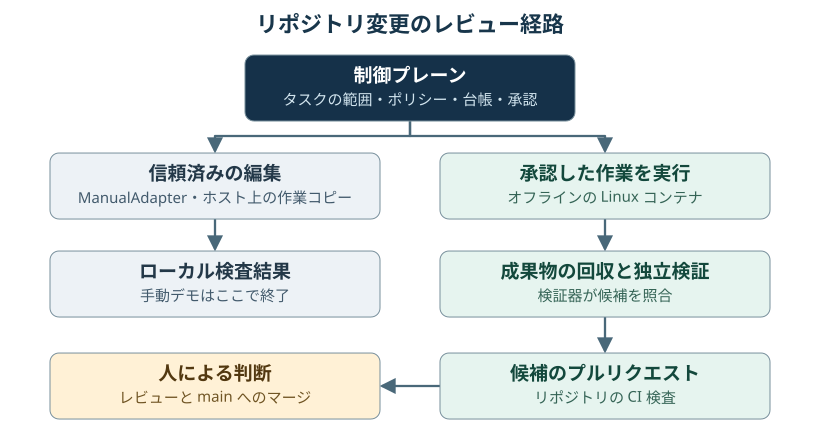

# アーキテクチャの見方 / Architecture overview

[全体仕様](ARCHITECTURE.md) · [Current capabilities](../operations/PROJECT_STATE.md)

## 現行の実行経路 / Current paths

手動デモは信頼済みの作業コピーでコマンドを実行し、ローカル結果を返す。隔離と独立した検証を必要とする作業には、[承認済みコンテナの経路](../operations/APPROVED_CONTAINER_LOOP.md)を使う。署名承認・台帳は制御プレーンが管理し、候補のマージは人が判断する。

The manual demo ends with local results. The offline Linux path separates worker execution from verification. The control plane owns approvals and ledger updates; a human reviews the candidate before merging. [English diagram](../diagrams/architecture.en.svg)

## エージェントを接続する設計 / Agent integration design

外部ツールを使う場合、認可の対象は個々の操作になる。文書の読み取り、草案の生成、送信、子への委譲について、依頼者・データ・宛先・費用をどこで確認するかは[ユースケース別設計](../agent-workflows/README.ja.md)を参照。

The [agent workflow design](../agent-workflows/README.md) traces a proposed tool action from request through policy, approval, execution and read-back. The [adapter guide](../adapters/README.md) describes the interfaces available today.
